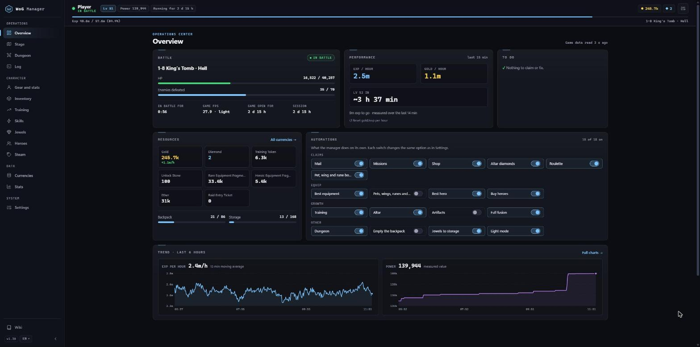
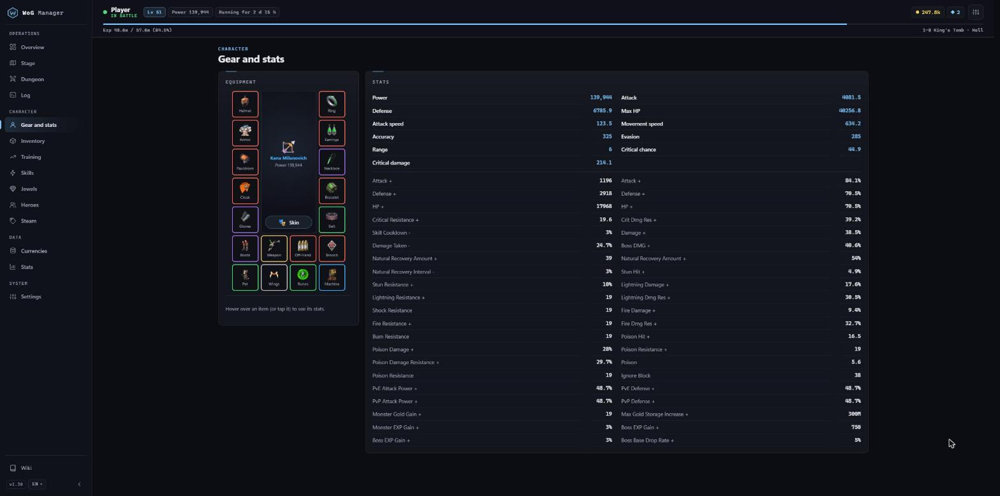
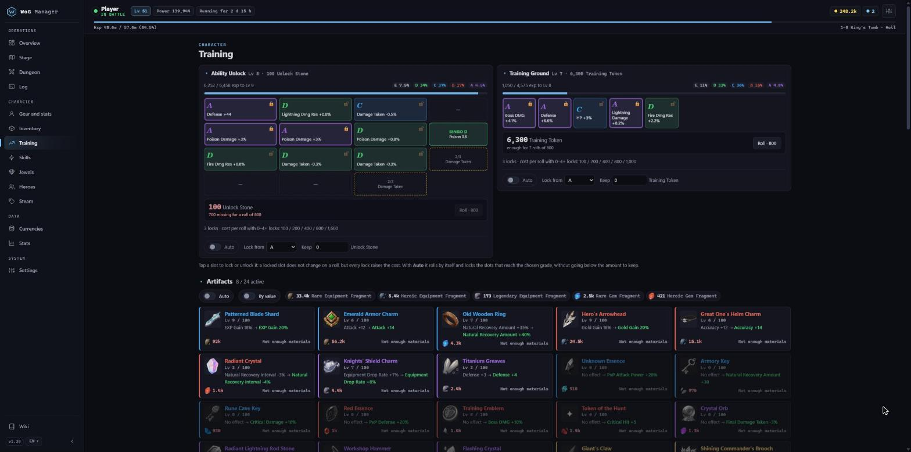
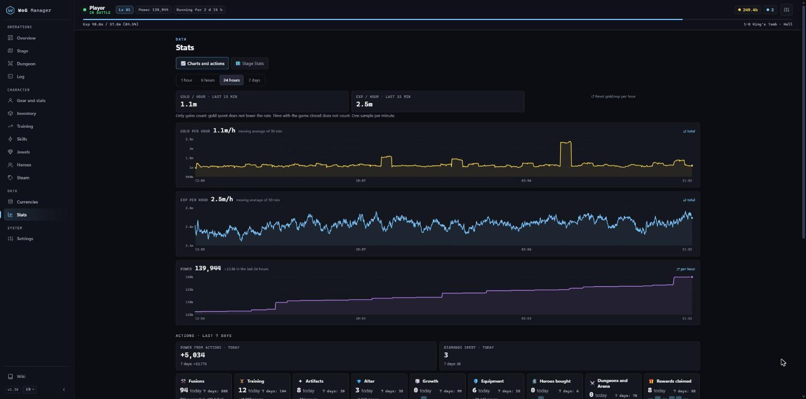

# WoG Manager

**[English](#english) · [Italiano](#italiano) · [中文](#中文)**

💎 **Want the Supporter features?** → [How to become a Supporter](#how-to-become-a-supporter)

<table>
  <tr>
    <td></td>
    <td></td>
    <td></td>
  </tr>
</table>

---

## English

Windows companion app for **War of Genesis: Idle Loot**. It runs next to the game and lets you manage your
character from a web page, on your PC or on your phone, without looking at the game window.

It reads the live game (level, power, stage, bag, storage, training, drops…) and uses the **same functions as the
game's own buttons**: no simulated clicks.

**What it does**

- Fusion, rewards and gear in one click, or automatically: mail, missions, shop, Altar diamonds, roulette
- Equips the best gear it finds in your storage
- Training, Altar, artifacts and Growth, Dungeon and Arena
- Charts of gold and EXP per hour, power over time, drop log by tier, stage stats
- Information the game doesn't show you, plus a built-in wiki
- Telegram alerts (for example when the game stops)
- Light mode for weaker PCs; the page is in English, Italian and Chinese

Some features are for **💎 supporters** (full fusion of every tier, pets/wings/runes, best hero, auto Dungeon and
Arena, all Telegram alerts, the Steam tab…). Everything else is free.

### How to become a Supporter

A **small one-time donation** unlocks the 💎 features.

1. Join our Discord: [Secret Library](https://discord.gg/xUbAa4FdUQ)
2. Go to **#get-key** and click the button to open a ticket
3. We reply in the ticket and send you your key
4. In WoG Manager open **Settings → Supporter** and paste the key

We never DM you first – keys only come from a ticket.

**Install**

1. Open [Releases](../../releases/latest) and download **WoGManager-Setup-vX.Y.exe**.
2. Run it and follow the setup.
3. On first launch WoG Manager finds the game by itself and guides you with "First steps".

New versions install themselves: the app only accepts installers signed by us.
This repository only contains the downloads (signed installers and release notes); the source code is private.

> ⚠️ **Warning:** WoG Manager modifies a game file and automates parts of the game. This is probably against the
> game's rules and **may get your account banned: use it at your own risk**. Not affiliated with the game's developers.

---

## Italiano

Programma per Windows che affianca **War of Genesis: Idle Loot**. Gira accanto al gioco e ti fa gestire il
personaggio da una pagina web, sul PC o sul telefono, senza guardare la finestra del gioco.

Legge il gioco dal vivo (livello, potenza, stage, zaino, storage, training, drop…) e usa le **stesse funzioni dei
bottoni del gioco**: niente clic simulati.

**Cosa fa**

- Fusioni, riscossioni ed equip con un clic o in automatico: posta, missioni, negozio, diamanti dell'Altare, roulette
- Mette l'equipaggiamento migliore che trova nello storage
- Training, Altare, artefatti e Growth, Dungeon e Arena
- Grafici di oro ed EXP all'ora, potenza nel tempo, drop per tier, statistiche degli stage
- Informazioni che il gioco non mostra, più una wiki integrata
- Avvisi su Telegram (per esempio quando il gioco si ferma)
- Modalità leggera per i PC meno potenti; la pagina è in italiano, inglese e cinese

Alcune funzioni sono per i **💎 supporter** (fusione completa di tutti i tier, pet/ali/rune, eroe migliore, Dungeon
e Arena automatici, tutti gli avvisi Telegram, la scheda Steam…). Tutto il resto è gratis.

### Come diventare supporter

Con una **piccola donazione, una volta sola**, sblocchi le funzioni 💎.

1. Entra nel nostro Discord: [Secret Library](https://discord.gg/xUbAa4FdUQ)
2. Vai in **#get-key** e clicca il bottone per aprire un ticket
3. Ti rispondiamo nel ticket e ti mandiamo la chiave
4. In WoG Manager apri **Impostazioni → Supporter** e incolla la chiave

Non ti scriviamo mai noi per primi in privato: le chiavi arrivano solo da un ticket.

**Come si installa**

1. Apri [Releases](../../releases/latest) e scarica **WoGManager-Setup-vX.Y.exe**.
2. Aprilo e segui l'installazione.
3. Al primo avvio WoG Manager trova il gioco da solo e ti guida con i "Primi passi".

Le nuove versioni si installano da sole: il programma accetta solo installer con la nostra firma.
Questo repository contiene solo le versioni da scaricare (installer firmati e note di versione): il codice è privato.

> ⚠️ **Attenzione:** WoG Manager modifica un file del gioco e ne automatizza alcune azioni. Probabilmente è contro le
> regole del gioco e **chi lo usa si assume il rischio di un ban**. Non è affiliato agli sviluppatori del gioco.

---

## 中文

**War of Genesis: Idle Loot** 的 Windows 辅助程序。它在游戏旁边运行，让你在电脑或手机上通过网页管理角色，
不用一直盯着游戏窗口。

它实时读取游戏数据（等级、战力、stage、背包、storage、training、掉落……），并使用**和游戏按钮相同的功能**：
不模拟点击。

**功能**

- 一键或自动完成合成、领取奖励和装备：邮件、任务、商店、Altar 钻石、轮盘
- 自动穿上 storage 中最好的装备
- Training、Altar、artifacts、Growth、Dungeon 和 Arena
- 每小时金币和 EXP 图表、战力变化、按 tier 统计的掉落、stage 统计
- 游戏里看不到的信息，以及内置 wiki
- Telegram 提醒（例如游戏停止时）
- 适合低配电脑的轻量模式；页面支持中文、英文和意大利文

部分功能仅限 **💎 supporter**（所有 tier 的完整合成、宠物/翅膀/符文、最佳英雄、自动 Dungeon 和 Arena、
全部 Telegram 提醒、Steam 页面……）。其余功能全部免费。

### 如何成为 Supporter

**一次性小额捐助**即可解锁 💎 功能。

1. 加入我们的 Discord：[Secret Library](https://discord.gg/xUbAa4FdUQ)
2. 进入 **#get-key** 频道，点击按钮开一个工单（ticket）
3. 我们会在工单里回复你，并把 key 发给你
4. 在 WoG Manager 中打开 **设置 → Supporter**，粘贴 key 即可

我们绝不会主动私信你：key 只会通过工单发放。

**安装**

1. 打开 [Releases](../../releases/latest)，下载 **WoGManager-Setup-vX.Y.exe**。
2. 运行安装程序，按提示完成安装。
3. 首次启动时，WoG Manager 会自动找到游戏，并通过“第一步”引导你完成设置。

新版本会自动安装：程序只接受带有我们签名的安装包。
本仓库只包含下载文件（已签名的安装包和版本说明），源代码不公开。

> ⚠️ **注意：** WoG Manager 会修改游戏的一个文件，并自动执行部分游戏操作。这很可能违反游戏规则，
> **使用者需自行承担账号被封禁的风险**。本程序与游戏开发商无关。
